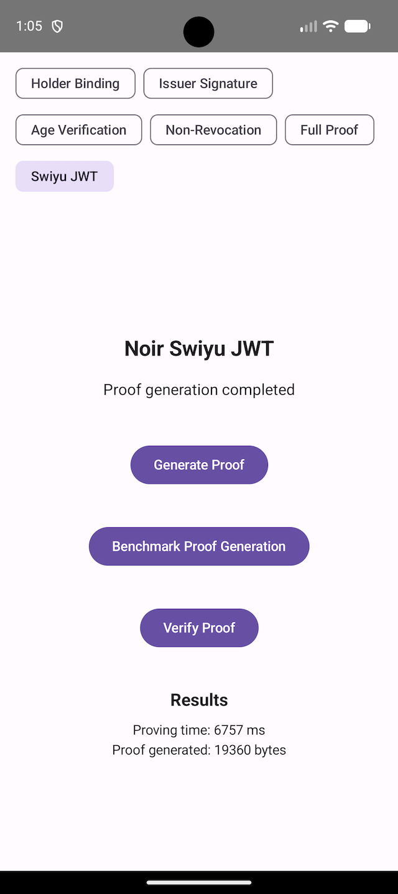

# zkp-android

## Overview

`zkp-android` is an Android application that demonstrates Noir Zero-Knowledge Proof (ZKP) generation and verification. The project is built with the `mopro` toolchain, which generates cross-platform bindings from Rust source code to Kotlin (Android) via UniFFI and JNA.

The circuits come from [zkp-pocs](https://github.com/eid-privacy/zkp-pocs), where the benchmark
results are listed. The blog post
[Verifiable SD-JWT Credential on Mobile](https://eid-privacy.github.io/wp2/2026/06/19/noir-benchmarking-mobile.html)
describes the app and its results.

<a href="./screenshot_swiyujwt.png"></a>

## Set up

All tooling is managed with [devbox](https://www.jetify.com/devbox) and the
`Makefile`. Enter the dev environment first:

```sh
devbox shell
```

Then install the toolchain (`srs_downloader`, `mopro-cli`) and build the native
bindings:

```sh
devbox run setup   # equivalent to: make setup
```

Download the SRS for each circuit and copy it into the Android assets:

> [!IMPORTANT]
> The app **will not work without this step**. Proof generation and verification
> require the structured reference string (SRS) for each circuit. The SRS files
> are large and are **not** committed to git, so you must download them yourself
> before running the app.

```sh
devbox run download-srs   # equivalent to: make download-srs
```

Finally, open the Android project in Android Studio:

```sh
studio android/
```

## Update bindings

After changing the Rust source, regenerate the Kotlin bindings:

```sh
mopro build --auto-update   # build + copy into android/
# or, to copy existing bindings only:
mopro update
```

## Update the circuits from zkp-pocs

The Noir circuits live in the [`zkp-pocs`](https://github.com/eid-privacy/zkp-pocs)
submodule. To rebuild them and copy the compiled circuit JSON into this project
(both `test-vectors/noir/` and `android/app/src/main/assets/`), run:

```sh
devbox run circuits   # equivalent to: make circuits
```

This initializes the submodule, runs `devbox run circuits` inside `zkp-pocs`
(which compiles the circuits), and copies the resulting `*.json` files into place.

> [!WARNING]
> After updating the circuits, the on-device proofs **will fail**. The proof
> inputs are hard-coded in the Android code, so a regenerated circuit no longer
> matches them. You must update the hard-coded inputs to match the new circuit
> before proofs will succeed again.

## Test

Run the Rust tests (the JNA jar is downloaded automatically if missing):

```sh
devbox run test   # equivalent to: make test
```
